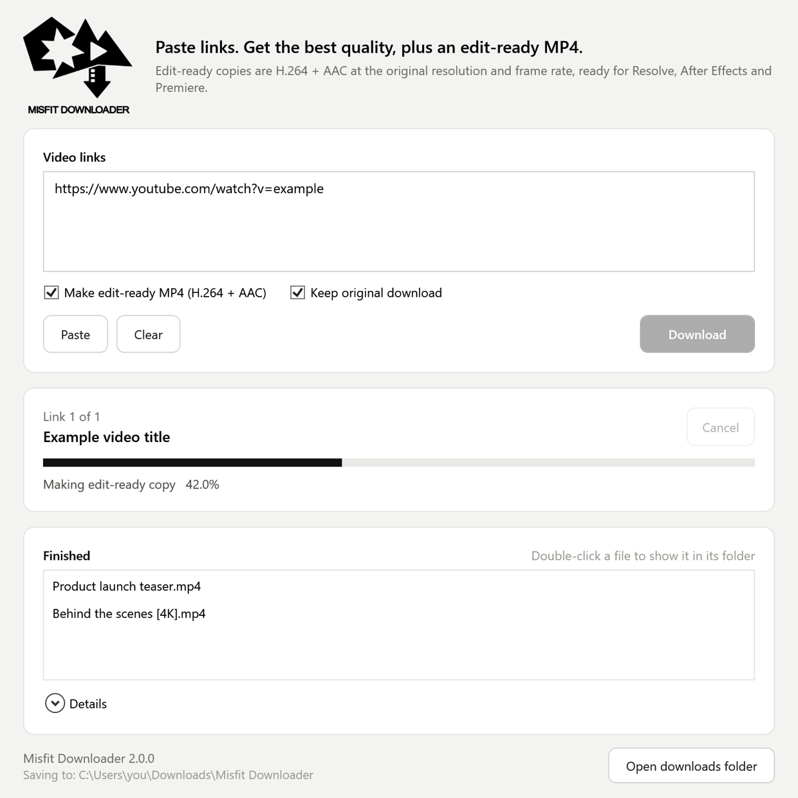

<p align="center"></p>

# Misfit Downloader

Paste video links and you get two things:

- **The original** at the highest quality the site offers (via [yt-dlp](https://github.com/yt-dlp/yt-dlp)).
- **An edit-ready MP4** (H.264 + AAC, constant frame rate, same resolution and frame rate) that drops straight into DaVinci Resolve, After Effects or Premiere. You don't need Handbrake anymore.

It works with YouTube, Vimeo, X/Twitter, Instagram, TikTok, Facebook, Reddit and [about 1,800 other sites](https://github.com/yt-dlp/yt-dlp/blob/master/supportedsites.md).

<p align="center"></p>

## Install (one time)

1. Download **[Install.bat](https://raw.githubusercontent.com/creativemisfitsnvm/VideoDownloader/main/Install.bat)**. If it opens as text, right-click the link and choose **Save link as...**
2. Double-click `Install.bat`. If Windows shows "Windows protected your PC", click **More info**, then **Run anyway**.
3. Wait while it downloads its tools (about 200 MB, one time only).

Or paste this into PowerShell:

```powershell
irm https://raw.githubusercontent.com/creativemisfitsnvm/VideoDownloader/main/install.ps1 | iex
```

Installation doesn't need admin rights. It adds a **Misfit Downloader** shortcut to your Desktop and Start menu, and it appears in **Settings > Apps > Installed apps**.

## Use

1. Open **Misfit Downloader**.
2. Paste one or more links, one per line, then click **Download**.
3. Watch the progress. Finished files are listed at the bottom, and you can double-click one to show it in its folder.

Your files go to **Downloads\Misfit Downloader**:

- `Downloads\Misfit Downloader\`: edit-ready MP4s for your editor.
- `Downloads\Misfit Downloader\Originals\`: untouched downloads.

Options:

- **Make edit-ready MP4:** turn this off to keep only the original download.
- **Keep original download:** turn this off to delete the original once its edit-ready copy is made.

## Updates are automatic

Every time the app opens, it:

- grabs the latest version from this repo and restarts itself if anything changed, and
- updates yt-dlp once a day, since sites change often.

If a tool goes missing, delete `%LOCALAPPDATA%\VideoDownloader\bin` and reopen the app. It downloads the tools again.

## Uninstall

Go to **Settings > Apps > Installed apps > Misfit Downloader > Uninstall**, or **Start menu > Misfit Downloader > Uninstall Misfit Downloader**. Your downloaded videos are kept.

## Notes

- **HDR videos** are tone-mapped to standard (SDR) color in the edit-ready copy so they don't look washed out.
- **Re-encoding takes time**, especially for long or 4K videos. The progress bar shows how far along it is.
- **Private or login-only videos** (private Instagram, members-only content and similar) won't download.
- **DRM services** such as Netflix, Disney+ and Prime Video are not supported.

## For maintainers

```
Install.bat               one-time installer (runs install.ps1 from GitHub)
install.ps1               bootstrap: downloads the repo, runs app/update.ps1 -Install
app/VideoDownloader.ps1   the app window (WPF); shortcuts point here
app/make-edit-ready.ps1   ffmpeg re-encode to H.264/AAC MP4 (also usable from the command line)
app/update.ps1            pulls app/* from this repo, installs/updates tools,
                          creates shortcuts, registers in Installed apps
app/uninstall.ps1         removes the app, shortcuts and Installed apps entry
app/logo.ico, logo.png    app icon and header logo
app/version.txt           version shown in the app and in Installed apps
docs/screenshot.png       README screenshot
```

- **Shipping a change:** edit files in `app/`, bump `app/version.txt`, and push to `main`. Everyone gets the change the next time they open the app.
- **Shortcut changes:** if you change how shortcuts are made, bump `$ShortcutsVersion` in `app/update.ps1` so every PC re-creates them once.
- **Encoding settings:** `$EditReadyCrf` and `$EditReadyPreset` at the top of `app/make-edit-ready.ps1`.
- **Screenshot:** run `powershell -STA -File app\VideoDownloader.ps1 -Screenshot docs\screenshot.png` to regenerate it.
- **Keep scripts ASCII-only.** Windows PowerShell 5.1 misreads non-ASCII characters in files without a BOM.
- **Tools** are downloaded from official sources and verified against their published SHA-256 checksums:
  - yt-dlp: [yt-dlp/yt-dlp releases](https://github.com/yt-dlp/yt-dlp/releases)
  - ffmpeg: [yt-dlp/FFmpeg-Builds](https://github.com/yt-dlp/FFmpeg-Builds/releases), the win64 GPL shared build
  - node: [nodejs.org](https://nodejs.org/dist/), current LTS `node.exe`, used as yt-dlp's JavaScript runtime
